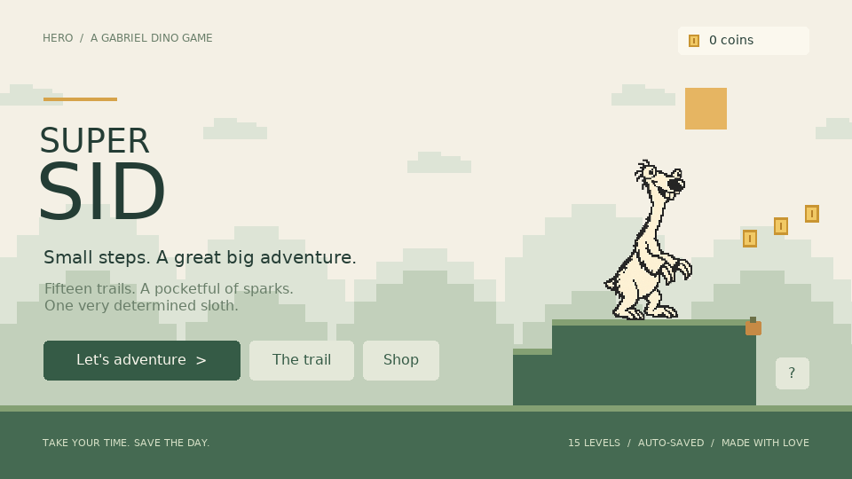
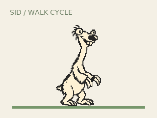
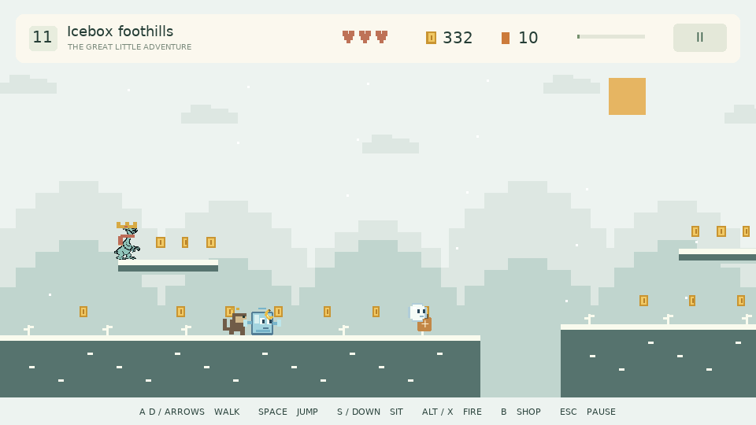

# Super Sid

A LÖVE / Lua platformer by Gabriel Dino.
Sid is a determined sloth with a pocketful of fireballs and twenty-five trails to explore.



## Play

On this Windows computer, double-click **`play.cmd`**. LÖVE 11.5 is already installed at `C:\Program Files\LOVE`.
The launcher also finds LÖVE on `PATH`.

On another computer, install [LÖVE 11.5](https://love2d.org/) and run the project folder:

```powershell
& 'C:\Program Files\LOVE\love.exe' .
```

```sh
# Linux / macOS with LÖVE on PATH
love .
```

Run the folder containing `main.lua`; no package installation or compilation is required.

## Controls

| Action | Keys |
| --- | --- |
| Walk in either direction | A / D or Left / Right |
| Jump | Space, W, or Up; hold for a higher jump |
| Extra air jump with Cloud step equipped | Release jump and press it again while airborne |
| Glide with the leaf parachute equipped | Hold Space, W, Up or the touch JUMP button while falling |
| Sit on the ground or a raised platform | Hold S or Down; release to stand |
| Shoot fireballs | Left / Right Alt or X; hold for repeated fire |
| Throw a carried grenade | G |
| Shop | B |
| Pause / back | Escape or P |
| Toggle sound | M |
| Toggle fullscreen | F11 |
| Menu navigation | Arrows or Tab, then Enter / Space |

Menus also accept clicks. Touch controls, including **SIT** and **GRENADE**, appear after the first touch on a touchscreen.
Sid and enemies face the direction they move, keeping their last direction when idle.
Sid walks and fires in the direction he faces. Jump on enemies to stomp them.
His walking animation alternates the feet, swings each hand and moves the head independently. Its rhythm follows
the distance walked, including when using Trail runners. It stops while idle, sitting, airborne or blocked by a wall.
The feet stay aligned with the platforms, and hats and footwear follow the animated body parts.



Every ground island has two raised platform tiers, arranged as steps with coins on both heights.
Climb from the ground to the first tier, then jump again to the second; wider islands also have a step on the right.
Each step is reachable with the normal jump, without spring boots. Sid lands on top, can rest there indefinitely,
and can jump through them from underneath. Holding a movement key or jumping gets him moving again.

The game renders at the window's native pixel density, including fonts and the Romanian fallback font.
Resizing, maximizing and fullscreen rebuild the rendering surface and fonts for the new resolution while
preserving the 16:9 play area and input coordinates. Pixel artwork keeps its original sharp-edged style.

## The adventure

- Twenty-five sequential levels with eleven scenery palettes, including a night marsh, Halloween trail, glacier, blizzard, and frozen summit.
- Levels 11–15 progressively increase gap width, shorten safe ground and ledges, speed up enemies, shorten banana cooldowns, and add more enemies.
- Levels 16–25 add mushroom paths, crystal scenery, lantern woods, golden terraces, a secret garden, snowy passes and cloud heights. They have longer trails, faster patrols and higher ground terraces. All routes and platform tiers remain reachable without purchased equipment.
- Collect coins, jump over gaps, avoid walking monkeys and flying birds, and reach the finish flag.
- Defeating a bird earns **10 coins**; defeating a monkey earns **5 coins**, whether stomped or shot. Rewards also count toward the level's coin total.
- **Eagles** patrol above the raised platforms in all twenty-five levels, beyond the first safe island. They warn with an exclamation mark before diving at Sid on the upper route. They take **exactly two bullet hits**, including meteor and frost fire, and award **10 coins**. Frost also freezes them; a grenade can defeat them in one explosion.
- Every monkey has **three bananas per attempt**, a visible wind-up before throwing, and small gold ammo marks above its head. It never reloads. Bananas hurt Sid, stop at terrain, and can be destroyed with fireballs.
- Level 11 introduces sliding **ice cubes with eyes and hands**. They take two normal fireballs; meteor fire melts them with one hit.
- Level 12 introduces **snowballs with eyes** that hop along their patrols. Levels 13–15 add denser bird patrols and more snowballs. Ice enemies resist freezing but still take damage from frost fire.
- Each attempt starts with at least **five fireballs**. Ammo pouches add five; unused ammo above five carries over.
- Three hearts per attempt (four with Brave heart), a checkpoint in every level, and unlimited retries.
- Collectible hearts restore **one missing heart**, up to the current three- or four-heart limit. A heart stays on the trail when Sid is already healthy.
- Find and carry **one grenade** at a time. Press **G** or tap **GRENADE** to throw it in Sid's facing direction. It bounces and explodes after **three seconds of play**, dealing two damage to enemies within a **140-pixel radius**. Its explosion does not hurt Sid; pausing also pauses the fuse. A carried grenade persists with progress, and spent grenades do not return on retry.
- Coins and collected pickups persist across retries, so the same pickup cannot be collected twice on an attempt.
- The shop has **36 items across three pages**: hats, two sizes of ammo pouch, six colors, two faster blasters, four special fire types, outfits, boots, charms, a coin magnet, a leaf parachute, a companion, an air-jump ability, cosmetic footsteps and three editor decoration packs. Use the **< / >** buttons, Page Up / Page Down, brackets, mouse wheel, or arrow selection to browse all pages.
- Purchased equipment stays owned. Click or select it again to equip or remove it. One item per equipment category is active at a time.
- Frost fireballs freeze an enemy for three seconds; another hit defeats it. Against eagles, the first frost hit also removes one of their two health points. Triple fire uses one ammo per three-projectile volley.
- Progress saves every two seconds during play and when pausing, shopping, finishing, or quitting. Leaving the application pauses play.
- Continue resumes the current level at its checkpoint if reached. Unlocked levels can be replayed from **The trail**.
- Completing level twenty-five wins the game. **Walk the trail again** starts another campaign while keeping purchases and coins.
- Saves upgrade automatically. Champions of the original ten-level game continue at level eleven; champions of the fifteen-level game continue at level sixteen. Coins and equipment stay intact; unfinished campaigns keep their current level, pickups and checkpoint.

### New shop finds

| Item | Coins | Effect |
| --- | --- | --- |
| Arctic blue | 25 | An icy blue color for Sid |
| Little royalty | 50 | A golden crown |
| Winter wanderer | 30 | A warm scarf outfit |
| Meteor spark | 65 | Two damage per fireball; melts ice cubes in one hit |
| Trailblazer | 60 | A fireball can hit two different enemies |
| Spring boots | 55 | Higher jumps while equipped |
| Brave heart | 70 | Start each attempt with four hearts |
| Banana umbrella | 45 | Block one banana per attempt |
| Coin magnet | 40 | Pull coins within 120 pixels toward Sid for 30 equipped seconds per attempt |
| Leaf parachute | 60 | Hold jump while descending to slow the fall; release to fall normally |
| Little companion | 150 | A friendly yellow chick follows Sid; cosmetic and harmless |
| Woodland pack | 50 | Unlock mushrooms, ferns and flowers in the editor |
| Crystal pack | 50 | Unlock crystals, ice flowers and sparkles in the editor |
| Trail signs pack | 50 | Unlock signs, lanterns and banners in the editor |
| Cloud step | 120 | One extra air jump; replenishes when landing |
| Trail runners | 65 | Walk at 240 pixels/second instead of 195 |
| Lucky coin | 90 | Collectible coins are worth two; bird and monkey rewards stay 10 / 5 |
| Big spark pouch | 20 | Add fifteen fireballs, up to the normal 99-ammo limit |
| Trail gentleman | 35 | A top hat with a golden ribbon |
| Flower crown | 28 | A crown of flowers that follows the head animation |
| Ocean breeze | 25 | A deep blue character color |
| Lavender dream | 25 | A soft purple character color |
| Rainy-day hero | 50 | A yellow raincoat outfit |
| Comet footsteps | 45 | Leave fading stars while walking |

Charms share one equipment slot. Heart and umbrella effects are set at the start of each attempt;
boots and special fire change immediately when equipped. Each special fireball or triple volley uses one ammo.
Magnet, parachute and companion have separate equipment slots and can be used together. The magnet's remaining
time appears below the HUD; unequipping it pauses the timer and re-equipping never refills it. Starting an attempt
resets it to 30 seconds. Decoration packs are permanent unlocks: buying them again costs nothing, and all purchased
packs remain available together without an equipment slot.
Cloud step and Comet footsteps also have separate slots. Trail runners share the boots slot with Spring boots;
Lucky coin shares the charm slot with Brave heart and Banana umbrella. Holding jump does not automatically use
the second jump: release and press it again in the air. Colors, hats, the raincoat and footsteps are cosmetic.



Saves live outside the repository in LÖVE's `hero-supersid` save directory, typically
`%APPDATA%\LOVE\hero-supersid` on Windows. `progress.bak` provides recovery if the latest save is damaged.
To reset everything, close the game and remove `progress.lua` and `progress.bak` from that directory.

## Level editor and Contrib levels

Open **Level editor** from the main menu to create a trail. Choose a tool on the left, then click or drag
on the map. Terrain is solid; platforms can be jumped through from below. A 24-pixel grid keeps objects aligned.

| Editor action | How |
| --- | --- |
| Add terrain | Select Terrain (1), then drag a rectangle |
| Add platforms | Select Platform (2), then drag horizontally |
| Add enemies | Select Monkey, Bird, Ice cube or Snowball (3–6), then click |
| Add an upper-route eagle | Select Eagle (R), then click in the upper part of the map |
| Add coins / ammo | Select Coins (7) and paint, or select Ammo (8) and click |
| Add hearts / grenades | Select Heart (H) or Grenade (G), then click near a surface |
| Add purchased decorations | Click the Decor selector above the map to cycle unlocked objects; use Decor (V) and click near a surface |
| Set start / finish / checkpoint | Select Sid start (9), Finish flag (0) or Checkpoint (C), then click near a surface |
| Remove an object | Select Eraser (E), or right-click an object |
| Undo / redo | Buttons, Ctrl+Z / Ctrl+Y, or Ctrl+Shift+Z |
| Pan through the level | Left / Right, A / D, mouse wheel or < / > buttons; Home / End for the edges |
| Name and author | Click either text field at the top |
| Change scenery or width | Theme and − / + buttons below the map |
| Save / save a separate copy | Save / Save copy buttons, Ctrl+S / Ctrl+Shift+S |
| Test with the actual game physics | Test button or F5; pause and choose Back to editor to continue editing |

Walking enemies snap to nearby platform surfaces and patrol their supporting platform. Birds fly at the height
where they are placed. Eagles start between y=100 and y=280 and dive at players on the upper route.
Hearts and grenade pickups snap to nearby surfaces. Move objects by erasing and placing them again. The starting template has a continuous
floor: erase it and draw separate terrain rectangles to make gaps. Shrinking a map requires moving or removing
objects beyond its new edge first. A level needs a supported start and finish before saving or testing;
the checkpoint is optional. The game prompts before leaving or closing an editor with unsaved changes.
Buy decoration packs in the main menu's Shop to unlock nine decorative objects. They are drawn behind Sid and
do not block movement. Saved and imported levels retain their decorations; other players can view, play and edit
those levels without buying the packs, while placing additional decorations requires the matching pack.

**Save** creates a `.sidlevel` file in the `levels` subfolder of LÖVE's save directory, usually
`%APPDATA%\LOVE\hero-supersid\levels` on Windows. The editor's **Folder** button opens that location.
Send that file to another player to share your level. **Save copy** creates a separate file without overwriting
the original. Levels saved in the editor appear in **Contrib levels**, where they can be played or reopened for editing.

To add a level made by someone else, choose **Contrib levels → Import level** and drop their `.sidlevel` file
onto the window. Alternatively, use **Open folder**, copy the files into it and press **Refresh**.
Imports receive a unique filename and do not overwrite existing levels. Invalid files are skipped with a message.
These are Super Sid level files; SuperTux `.stl` files use a different format.

Custom play uses a separate copy of your equipment and progress. Its collected coins, kill bonuses, ammo,
checkpoints and retries work during that session; campaign coins, unlocks and saves stay separate.
The editor validates object bounds and basic marker/enemy placement; use Test to check that your route is beatable.
Shared files contain data only and are parsed without executing Lua. Format details are in [LEVELS.md](docs/LEVELS.md).

## Development and verification

```sh
lua tests/run.lua
```

The **55 integration tests** check geometry and full traversal of all twenty-five trails at **30 / 60 / 144 FPS**,
two rewarded raised tiers on every island, every raised platform's jump reachability from its preceding step,
stable standing/sitting at those frame rates, facing and patrol turns,
ammunition, combat, kill rewards for stomps and every fire type, damage immunity, banana limits and collisions, progression, checkpoints, pickup persistence,
shop balances and equipment, new gear and special fire, ice enemies, save recovery, and migration of old saves.
They also cover level-file round trips and validation, imports and filename collisions, editor drawing and history,
failed saves, custom checkpoints and retries, campaign isolation, and solid terrain versus one-way platforms.
Expansion checks cover magnet range and expiry, parachute input and landing, companion behavior, decoration pack
ownership and file sharing, save migration, and all ten new level layouts.
Animation checks verify distance-based stepping at all three frame rates, separate head/hand/foot motion and a
planted foot. New shop checks cover the air-jump limit and reset, running speed, coin values, bulk ammo, cosmetic
particles and saved ownership.
Combat checks cover eagle warning/diving and two-hit health with every fire type, heart limits, grenade capacity,
three-second fuses at all three frame rates, bouncing, circular blast damage, pickup persistence, version-3 level
sharing and editor history. Viewport checks cover native pixel density, aspect ratio and input mapping.

The installed engine can check rendering and UI interactions directly from source:

```powershell
& 'C:\Program Files\LOVE\lovec.exe' . --smoke
```

The smoke run checks input callbacks, shop pagination and new purchases, Sid climbing both raised tiers and sitting at the top,
editor mouse drawing and text input, saving and testing, imports, the Contrib levels list, custom results and retries.
It renders gameplay, editor and native-window screenshots plus 32 walk-cycle frames, including all three shop pages, all nine editor decorations,
gliding with a companion, new scenery, the complete 25-level route, import and unsaved-change dialogs, animated
poses, new accessories and custom gameplay. Pixel comparisons verify movement in the rendered head, hands and
feet and stability while idle. The new shop purchases and extra jump are also exercised through game callbacks.
It also exercises eagle attacks, healing, grenade throws and explosions, and saving/importing the new editor objects.
Rendering checks verify actual canvas pixel sizes and font density at 960×540, 1600×900, maximized and fullscreen sizes.
It writes screenshots to the LÖVE save directory's `smoke` folder, writes test levels only inside `smoke/levels`, and exits.
It uses temporary in-memory progress and does not change your campaign save.

| File | Purpose |
| --- | --- |
| `main.lua` | Menus, input, state transitions, viewport, runtime smoke check |
| `src/game.lua` | Movement, collisions, combat, pickups, checkpoints, progression |
| `src/actors.lua` | Shared facing convention for the hero and enemies |
| `src/eagles.lua` | Upper-route patrols, warnings and committed dive attacks |
| `src/grenades.lua` | Timed throws, bouncing and circular blast range |
| `src/viewport.lua` | Aspect ratio, native rendering density and input coordinates |
| `src/sid_animation.lua` | Distance-based walk pose and separate head, hand and foot transforms |
| `src/sid_mesh.lua` | Textured walk mesh using the original Sid artwork |
| `src/levels.lua` | Twenty-five deterministic level layouts, difficulty, and themes |
| `src/decorations.lua` | Shared decoration types, sizes and pack ownership |
| `src/custom_levels.lua` | Data-only level format, validation, library, import/export and runtime conversion |
| `src/editor.lua` | Grid tools, placement, erasing, undo/redo, resizing and saving |
| `src/editor_view.lua` | Editor and Contrib levels interfaces |
| `src/shop.lua` | Catalog, purchases, equipment |
| `src/render.lua` | Pixel scenery, character rendering, HUD, menus |
| `src/save.lua` | Persistent progress, validation, backup recovery |
| `src/audio.lua` | Original synthesized sound effects |
| `assets/sid.png` | Generated transparent Sid sprite |
| `assets/DejaVuSans.ttf` | Fallback font for extended characters, including Romanian; license included alongside it |
| `docs/ART.md` | Image-generation prompt and asset provenance |

This repository contains runnable source. No executable distributions have been built or committed.
The inherited `Desktop/AGENTS.md` requires confirmation before commits or pushes, excludes executables
from Git, and requires Windows x64 single-file executable, Android APK, and Linux AppImage variants
whenever distribution builds are made.

Local Git author: **Gabriel Dino** `<sirius.gabriel2015@gmail.com>`.
GitHub repository: [gabriel-dino/SuperSid](https://github.com/gabriel-dino/SuperSid).
