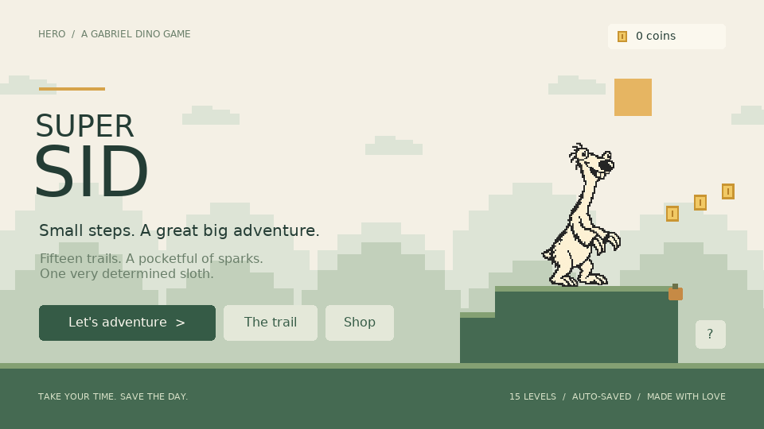
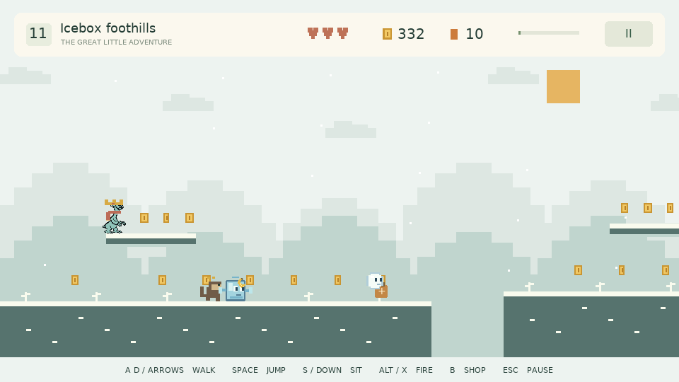

# Super Sid

A LÖVE / Lua platformer by Gabriel Dino.
Sid is a determined sloth with a pocketful of fireballs and fifteen trails to explore.



## Play

On this Windows computer, double-click **`play.cmd`**. LÖVE 11.5 is already installed at `C:\Program Files\LOVE`.
The launcher also finds LÖVE on `PATH`.

On another computer, install [LÖVE 11.5](https://love2d.org/) and run the project folder:

```powershell
& 'C:\Program Files\LOVE\love.exe' .
```

```sh
# Linux / macOS with LÖVE on PATH
love .
```

Run the folder containing `main.lua`; no package installation or compilation is required.

## Controls

| Action | Keys |
| --- | --- |
| Walk in either direction | A / D or Left / Right |
| Jump | Space, W, or Up; hold for a higher jump |
| Sit on the ground or a raised platform | Hold S or Down; release to stand |
| Shoot fireballs | Left / Right Alt or X; hold for repeated fire |
| Shop | B |
| Pause / back | Escape or P |
| Toggle sound | M |
| Toggle fullscreen | F11 |
| Menu navigation | Arrows or Tab, then Enter / Space |

Menus also accept clicks. Touch controls, including **SIT**, appear after the first touch on a touchscreen.
Sid, monkeys, birds, ice cubes, and snowballs face the direction they move, keeping their last direction when idle.
Sid walks and fires in the direction he faces. Jump on enemies to stomp them.
Raised platforms are reachable with the normal jump. Sid lands on top, can rest there indefinitely,
and can jump through them from underneath. Holding a movement key or jumping gets him moving again.

## The adventure

- Fifteen sequential levels with eleven scenery palettes, including a night marsh, Halloween trail, glacier, blizzard, and frozen summit.
- Levels 11–15 progressively increase gap width, shorten safe ground and ledges, speed up enemies, shorten banana cooldowns, and add more enemies.
- Collect coins, jump over gaps, avoid walking monkeys and flying birds, and reach the finish flag.
- Every monkey has **three bananas per attempt**, a visible wind-up before throwing, and small gold ammo marks above its head. It never reloads. Bananas hurt Sid, stop at terrain, and can be destroyed with fireballs.
- Level 11 introduces sliding **ice cubes with eyes and hands**. They take two normal fireballs; meteor fire melts them with one hit.
- Level 12 introduces **snowballs with eyes** that hop along their patrols. Levels 13–15 add denser bird patrols and more snowballs. Ice enemies resist freezing but still take damage from frost fire.
- Each attempt starts with at least **five fireballs**. Ammo pouches add five; unused ammo above five carries over.
- Three hearts per attempt (four with Brave heart), a checkpoint in every level, and unlimited retries.
- Coins and collected pickups persist across retries, so the same pickup cannot be collected twice on an attempt.
- The shop has **20 items across two pages**: hats, ammo, four colors, two faster blasters, four special fire types, outfits, boots, and charms. Use the **< / >** buttons, Page Up / Page Down, brackets, mouse wheel, or arrow selection to browse both pages.
- Purchased equipment stays owned. Click or select it again to equip or remove it. One item per equipment category is active at a time.
- Frost fireballs freeze an enemy for three seconds; another hit defeats it. Triple fire uses one ammo per three-projectile volley.
- Progress saves every two seconds during play and when pausing, shopping, finishing, or quitting. Leaving the application pauses play.
- Continue resumes the current level at its checkpoint if reached. Unlocked levels can be replayed from **The trail**.
- Completing level fifteen wins the game. **Walk the trail again** starts another campaign while keeping purchases and coins.
- Saves from the original ten-level game upgrade automatically. Former champions continue at level eleven with coins and equipment intact; unfinished campaigns keep their current level and checkpoint.

### New shop finds

| Item | Coins | Effect |
| --- | --- | --- |
| Arctic blue | 25 | An icy blue color for Sid |
| Little royalty | 50 | A golden crown |
| Winter wanderer | 30 | A warm scarf outfit |
| Meteor spark | 65 | Two damage per fireball; melts ice cubes in one hit |
| Trailblazer | 60 | A fireball can hit two different enemies |
| Spring boots | 55 | Higher jumps while equipped |
| Brave heart | 70 | Start each attempt with four hearts |
| Banana umbrella | 45 | Block one banana per attempt |

Charms share one equipment slot. Heart and umbrella effects are set at the start of each attempt;
boots and special fire change immediately when equipped. Each special fireball or triple volley uses one ammo.



Saves live outside the repository in LÖVE's `hero-supersid` save directory, typically
`%APPDATA%\LOVE\hero-supersid` on Windows. `progress.bak` provides recovery if the latest save is damaged.
To reset everything, close the game and remove `progress.lua` and `progress.bak` from that directory.

## Development and verification

```sh
lua tests/run.lua
```

The **20 integration tests** check geometry and full traversal of all fifteen trails at **30 / 60 / 144 FPS**,
every raised platform's jump reachability and stable standing/sitting at those frame rates, facing and patrol turns,
ammunition, combat, damage immunity, banana limits and collisions, progression, checkpoints, pickup persistence,
shop balances and equipment, new gear and special fire, ice enemies, save recovery, and migration of old saves.

The installed engine can check rendering and UI interactions directly from source:

```powershell
& 'C:\Program Files\LOVE\lovec.exe' . --smoke
```

The smoke run checks input callbacks, shop pagination and new purchases, Sid landing and sitting on a raised ledge,
and renders twelve screenshots, including a facing comparison for Sid and all four enemy types.
It writes screenshots to the LÖVE save directory's `smoke` folder and exits.
It uses temporary in-memory progress and does not change your campaign save.

| File | Purpose |
| --- | --- |
| `main.lua` | Menus, input, state transitions, viewport, runtime smoke check |
| `src/game.lua` | Movement, collisions, combat, pickups, checkpoints, progression |
| `src/actors.lua` | Shared facing convention for the hero and enemies |
| `src/levels.lua` | Fifteen deterministic level layouts, difficulty, and themes |
| `src/shop.lua` | Catalog, purchases, equipment |
| `src/render.lua` | Pixel scenery, character rendering, HUD, menus |
| `src/save.lua` | Persistent progress, validation, backup recovery |
| `src/audio.lua` | Original synthesized sound effects |
| `assets/sid.png` | Generated transparent Sid sprite |
| `docs/ART.md` | Image-generation prompt and asset provenance |

This repository contains runnable source. No executable distributions have been built or committed.
The inherited `Desktop/AGENTS.md` requires confirmation before commits or pushes, excludes executables
from Git, and requires Windows x64 single-file executable, Android APK, and Linux AppImage variants
whenever distribution builds are made.

Local Git author: **Gabriel Dino** `<sirius.gabriel2015@gmail.com>`.
No remote repository is configured.
